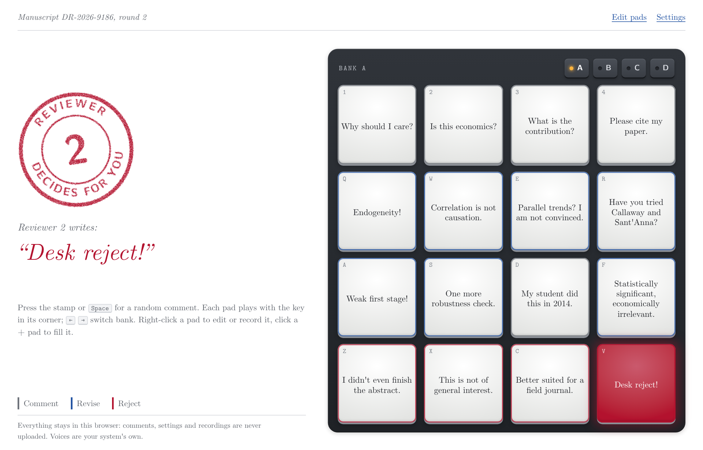

# Desk Reject

A Reviewer 2 soundboard for research meetings. Press a pad and the comment is read aloud; press the stamp and Reviewer 2 picks one for you. At the end of the seminar, download the decision letter.



It runs in any modern browser at **[marcorosso.com/desk-reject](https://marcorosso.com/desk-reject/)**, can be added to the home screen of a phone or tablet, and also comes as a desktop app for macOS, Windows and Linux. No account, no server, nothing leaves your device.

## Download

Get the desktop app from the [latest release](https://github.com/marcorosso768/desk-reject/releases/latest):

| Computer | File |
|---|---|
| Mac with Apple Silicon (M1 and later) | `Desk-Reject-<version>-mac-arm64.dmg` |
| Mac with an Intel processor | `Desk-Reject-<version>-mac-x64.dmg` |
| Windows | `Desk-Reject-Setup-<version>.exe` |
| Linux | `Desk-Reject-<version>.AppImage` |

On a Mac, open the dmg and drag Desk Reject onto Applications. The app is not signed with an Apple Developer ID, so the first time macOS blocks it: open *System Settings → Privacy & Security* and press *Open Anyway*.

## What it does

- **Four banks of sixteen pads.** The board is a 4 × 4 grid of rubber pads, like a drum machine. Bank *A* (Reviewer 2) holds the classics ("Why should I care?", "Is this economics?", "Correlation is not causation."), bank *B* (Unleashed) the meaner ones, and *C*–*D* start empty. A pad lights up while it plays; a long comment gets a smaller font, never a bigger pad.
- **Reviewer 2 decides.** The red stamp plays a random comment, never the same one twice in a row, from the pads and from a reserve of comments that sit on no pad.
- **Referee report.** Every comment played is logged for the current manuscript. *Generate report* shows the list and the decision (accept, minor or major revision, reject, desk reject) and gives a one-page decision letter as a PDF, stamp included: *Download PDF* in the browser, *Save PDF* (with the usual Save dialog) in the desktop app. *Next round* keeps the manuscript and starts an empty round; *New manuscript* starts over.
- **Your own board.** A blank pad with a **+** lets you write a new comment, record one with your own voice, or bring an existing one there. Under *Edit pads* you can edit, move and delete comments: drag a pad onto another to swap them, onto a bank button to move it to that bank, or onto the *Reserve* to take it off the grid.
- **Your own voice.** Any comment can be recorded from the microphone; the recording then plays instead of the system voice.
- **Share a board.** *Settings → Share link* gives a link and a QR code that carry the comments, their types and the banks (not the recordings). *Export board* saves everything, recordings included, to a file that a colleague opens with *Import board*.

Keyboard: the pads follow the keyboard grid <kbd>1</kbd><kbd>2</kbd><kbd>3</kbd><kbd>4</kbd> / <kbd>Q</kbd><kbd>W</kbd><kbd>E</kbd><kbd>R</kbd> / <kbd>A</kbd><kbd>S</kbd><kbd>D</kbd><kbd>F</kbd> / <kbd>Z</kbd><kbd>X</kbd><kbd>C</kbd><kbd>V</kbd>; <kbd>Space</kbd> plays a random comment, <kbd>←</kbd> <kbd>→</kbd> switch bank, <kbd>Esc</kbd> stops. Right-click (or long-press on a touch screen) a pad to edit or record it.

## Desktop app extras

- **Shortcuts in other apps.** In *Settings*, turn on *Shortcuts in other apps*: hold <kbd>Control</kbd> + <kbd>Option</kbd> (<kbd>Ctrl</kbd> + <kbd>Alt</kbd> on Windows and Linux) and press a pad's key, <kbd>Space</kbd>, <kbd>←</kbd> <kbd>→</kbd> or <kbd>Esc</kbd> while Keynote or PowerPoint is in front. Off by default, so it never clashes with other apps unless you want it.
- **Updates.** At startup the app checks for a new release (also *Check for Updates…* in the app menu). On a Mac it downloads the update, verifies it, replaces itself and restarts; on Windows it runs the new installer; on Linux it downloads the new AppImage. If the Mac app cannot replace itself (for example when opened straight from the dmg) it downloads the dmg instead.
- **Icon.** It follows the system's light or dark appearance; on macOS 26 and later also in Finder and Launchpad, when the app is closed.
- It keeps its own storage, separate from any browser.

## On a phone or tablet

Open the site and choose *Share → Add to Home Screen* (iPhone, iPad) or *Install app* (Android, Chrome, Edge). It opens full screen, fits the screen without scrolling, works offline and updates itself the next time it is opened online. The home-screen icon is the dark one: iOS cannot switch it with the theme.

## Privacy

Everything stays on the device that uses it. Comments, settings and the report log live in `localStorage`, recordings in IndexedDB. Nothing is uploaded, and there is no analytics. A share link contains the board itself, in the part of the address after `#`, which browsers do not send to the server.

## Voices

Speech comes from the voices installed on each device, so the same board can sound different on two machines. Better voices (Enhanced or Premium) can be downloaded in the system settings; *Settings → Better voices* in the app says where, for the system you are on. Siri voices are not available to apps.

The repository deliberately contains **no generated audio**: audio produced by operating-system voices usually may not be redistributed, so the app synthesises speech on each device instead.

## Run it locally

```bash
git clone https://github.com/marcorosso768/desk-reject.git
cd desk-reject
python3 -m http.server 8000        # web version: open http://localhost:8000
npm install && npm start           # desktop app
```

Browsers only allow microphone recording on `https://` or `localhost`.

## Releasing a new version

1. `npm version patch` (or `minor`, `major`): this updates `package.json` and creates the tag.
2. `git push --follow-tags` (in GitHub Desktop, *Push origin* also pushes the tag).
3. `.github/workflows/release.yml` builds the apps and attaches them to a GitHub release; `.github/workflows/pages.yml` publishes the web version on every push to `main`.

When you change a file listed in `sw.js`, bump `VERSION` there so installed web apps pick up the update. Building the macOS 26 icon needs Xcode 26; without it the build still works, with the light icon only.

## Change the built-in comments

The preset lives in [`assets/presets.js`](assets/presets.js). Each comment has `text`, a `severity` (`comment`, `revise` or `reject`) and `board`: `true` for a pad (the first 16 fill bank A, the next 16 bank B), `false` for the reserve. People who have already opened the app keep their own board until they choose *Settings → Reset to the Reviewer 2 preset*.

## Project layout

```
index.html            page structure
assets/app.js         behaviour (plain JavaScript, no build step)
assets/presets.js     built-in board
assets/style.css      typesetting and layout
assets/fonts/         Computer Modern Unicode (OFL); fonts/pdf/ are subsets for the report
assets/vendor/        jsPDF (MIT) for the report, qrcode-generator (MIT) for share links
assets/icons/         app icons
manifest.webmanifest  install metadata
sw.js                 offline cache (web version)
electron/             desktop shell: main process, preload, macOS self-updater
build/                desktop app icons for the installers (AppIcon.icon: Icon Composer, light + dark)
build-scripts/        afterPack hook: compiles the macOS 26 icon with actool, ad-hoc signs the app
package.json          desktop app version, scripts and build settings
```

## License

Code: MIT, see [LICENSE](LICENSE). Fonts: Computer Modern Unicode, SIL Open Font License 1.1, see [assets/fonts/OFL.txt](assets/fonts/OFL.txt). Bundled libraries keep their own MIT licences: [jsPDF](https://github.com/parallax/jsPDF) and [qrcode-generator](https://github.com/kazuhikoarase/qrcode-generator).
